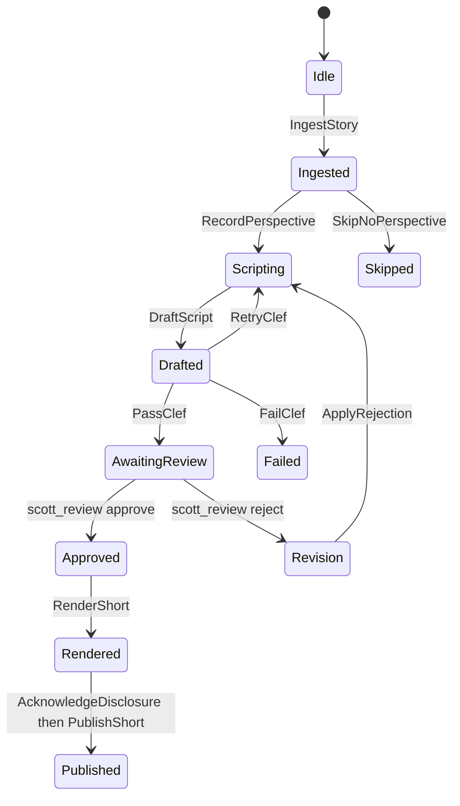

# Pundit — news-commentary Shorts

State machine for Scott Scoble's news-commentary YouTube Shorts pipeline.
The speck records stages and the guards between them. It does not fetch
news, read git repositories, call Clef, render audio, or upload video.
Those are ports in [`pundit/ports.ts`](pundit/ports.ts). Nothing in that
file performs I/O.

`speckl -t camel` emits one HTTP route per action (Camel 4.8 / camel-quarkus).
There is no timer route and no generated saga. The integrator posts to the
routes in the order the guards allow. A route runs its processor, which
throws `IllegalStateException` when the guard fails, so a call out of
order does not move the stage.

## Stages



| Stage | Value | How it is left |
|---|---|---|
| Idle | 0 | `IngestStory` consumes one story (headline, source URLs, facts are the caller's payload) |
| Ingested | 1 | `RecordPerspective` when the perspective port returns a cited take, otherwise `SkipNoPerspective` |
| Scripting | 2 | `DraftScript` takes the pluggable trend-signal string |
| Drafted | 3 | `PassClef`, `RetryClef` (retries &lt; 3), or `FailClef` (retries &gt;= 3) |
| AwaitingReview | 4 | Wait for Scott. Notify him. Do not auto-send |
| Approved | 5 | Only the `scott_review` approve signal assigns this |
| Rendered | 6 | `AcknowledgeDisclosure`, then `PublishShort` |
| Published | 7 | Terminal |
| Skipped | 8 | Terminal. No grounded take. No invented opinion |
| Failed | 9 | Terminal. Clef retry budget spent. Needs attention |
| Revision | 10 | Scott rejected. `ApplyRejection` returns to scripting and clears the Clef budget |

`RetryClef` may run three times (`retries` goes 0, then 1, then 2, then 3).
The next below-threshold result is `FailClef`. A pass on a later draft
still reaches review. Human rejection resets `retries` to 0.

While the machine is in `AwaitingReview`, `mode in` blocks every tool.
Approval is call-bound to one exact `render_short` call. Rejection or the
seven-day timeout goes to `Revision` and does not authorize a render.
`PublishShort` requires the render-from-approval flag and an acknowledged
disclosure. There is no action that assigns `Published` from any earlier stage.

## What is stubbed

The Z3 backend drops a guard that names an action parameter, and then it
will not treat the file as a proof. The numeric Clef compare and the
citation check therefore live in `pundit/ports.ts`, not in the speck.
The generated `passClef` route does **not** compare `scoreMilli`. Callers
use `clefDecision`. `RecordPerspective` stores that a cited take was
accepted; `perspectiveDecision` is what checks that the take has citations.

| Port | Real system | What this repo does |
|---|---|---|
| `PerspectiveSource` | Scott's GitHub repos, Forgejo repos, and Obsidian vault git repo | Interface only. No clone, no fetch. Null means skip |
| `TrendSignals` | Whatever is performing well on YouTube Shorts (patterns, hooks, length, topics) | Interface only. `DraftScript` receives one string |
| `ClefEvaluator` | Cloudflare Workers AI Clef, `POST .../ai/run/@cf/cloudflare/clef`, a noul question. Pass iff `noul >= 0.8` (`scoreMilli >= 800`). See [the Clef API guide](https://clefdecide.com/clef-api) | `clefDecision` maps a score to `pass`, `retry`, or `fail`. No HTTP client |
| `ShortRenderRequest` | ElevenLabs voice named `Scott Scoble`, 9:16, captions, on-screen source credit | The voice id is not in this repo. No TTS client |
| YouTube | Data API `videos.insert` / `videos.update`, `status.containsSyntheticMedia: true` | Constant name only. No upload client |

Notification is the await prompt: tell Scott a script is waiting. No mail
or chat client is generated, and nothing is sent automatically.

The script itself must be clearly an opinion, cite the recorded sources on
screen, not attribute words to a real person, and not defame. Those rules
are instructions on the generated agent rails. The speck does not judge
prose.

## What Z3 checks

At bounded depth 10, all seven invariants are proofs (`unsat`), including
`PublishNeedsApproval`, `RenderedNeedsApproval`, and `RetriesBounded`.
The synthetic `__signal_scott_review_approve` / `_reject` edges are in the
transition relation. Weakening `RenderShort` so it can run from
`AwaitingReview` makes `RenderedNeedsApproval` fail. These checks do not
model signed bytes, Clef's HTTP response, or YouTube.

## Config and secrets

This repository reads none of these. An integrator supplies them outside
the generated route:

| Secret or config | Used for |
|---|---|
| `CLOUDFLARE_ACCOUNT_ID`, `CLOUDFLARE_API_TOKEN` (Workers AI) | Clef `POST /accounts/{account_id}/ai/run/@cf/cloudflare/clef` |
| `ELEVENLABS_API_KEY`, and the voice id for the voice named `Scott Scoble` | Render. The id is resolved by the integrator |
| YouTube OAuth client (Data API) | Upload, with `status.containsSyntheticMedia` set true |
| Git remotes and credentials for Scott's GitHub, Forgejo, and Obsidian vault repositories | Perspective lookup. Paths are not pinned here |
| Trend-signal provider credentials, if that plug-in has any | `TrendSignals.current()` |
| Ed25519 key pinned at `signal.mjs init --signer` | Scott's `scott_review` file-drop. Do not use the dev CLI verifier |

## Try it

```bash
cd compiler
npm ci && npm run build
node dist/index.js ../examples/Pundit.speckdl -t camel -o out
node dist/index.js ../examples/Pundit.speckdl -t z3 -o out
z3 out/Pundit.smt2
npm test -- example-pundit
```

The Camel project is `out/camel/pundit`. Routes: `ingestStory`,
`recordPerspective`, `skipNoPerspective`, `draftScript`, `passClef`,
`retryClef`, `failClef`, `applyRejection`, `renderShort`,
`acknowledgeDisclosure`, `publishShort`.
